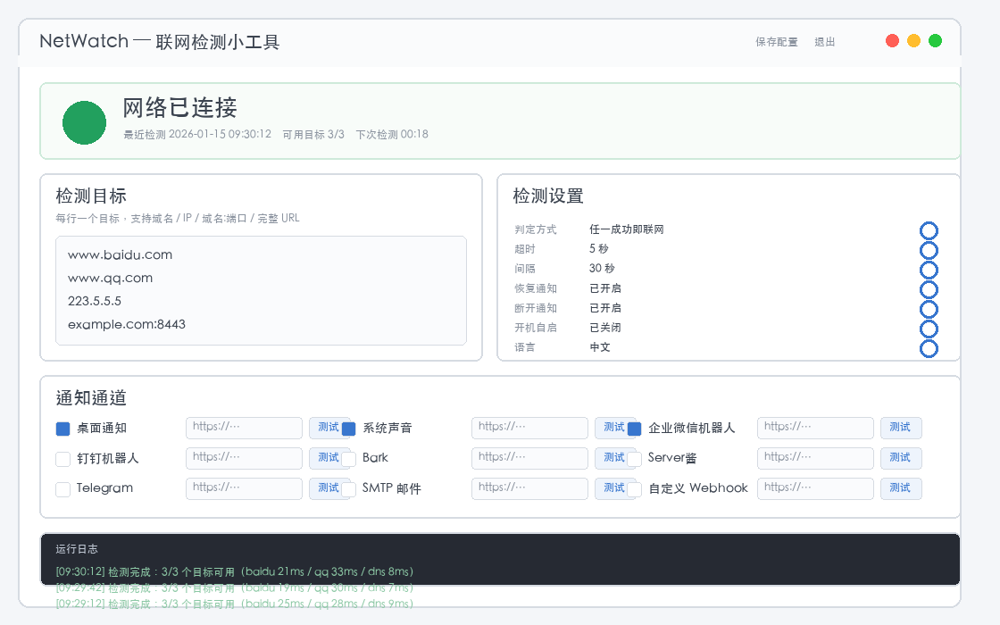

# NetWatch

> 跨平台「联网检测小工具」——定时检查你关心的域名是否还在线，一断网一恢复，立刻把消息推到你手上。

NetWatch 是一个用 Python + tkinter 写的轻量级联网检测工具。它会按你设定的间隔并发探测若干个域名或 IP，
在**断网**和**恢复联网**两个时刻通过你选择的通道（桌面通知、系统声音、企业微信机器人、钉钉机器人、Bark、
Server酱、Telegram、SMTP 邮件、自定义 Webhook）发送提醒，支持开机自启动与系统托盘。

- 纯标准库实现，**零第三方运行依赖**
- 跨平台：Windows 10/11、macOS 12+、Linux（X11 / Wayland）
- 只检测你关心的地址，不做多余的流量与后台服务

---

## 目录

- [功能特性](#功能特性)
- [界面截图](#界面截图)
- [快速开始](#快速开始)
- [配置文件位置](#配置文件位置)
- [通知通道配置](#通知通道配置)
  - [企业微信机器人（详细步骤）](#企业微信机器人详细步骤)
  - [钉钉机器人](#钉钉机器人)
  - [Bark](#bark)
  - [Server酱](#server酱)
  - [Telegram](#telegram)
  - [SMTP 邮件](#smtp-邮件)
  - [自定义 Webhook](#自定义-webhook)
  - [桌面通知与系统声音](#桌面通知与系统声音)
- [开机自启动](#开机自启动)
- [命令行用法](#命令行用法)
- [构建与发布](#构建与发布)
- [常见问题 FAQ](#常见问题-faq)
- [开源协议与致谢](#开源协议与致谢)

---

## 功能特性

| 分类 | 能力 |
|---|---|
| 检测 | 自定义检测目标（域名 / IP / `域名:端口` / 完整 URL）；「任一成功」或「全部成功」两种判定方式；单目标超时 1–30 秒可调；检测间隔 5–3600 秒可调 |
| 通知 | 9 条通知通道可独立开关：桌面通知、系统声音、企业微信机器人、钉钉机器人、Bark、Server酱、Telegram、SMTP 邮件、自定义 Webhook |
| 触发时机 | 断网提醒、恢复联网提醒、启动时提醒一次、手动「测试」通知 |
| 界面 | tkinter 图形界面：顶部状态灯 + 倒计时、检测目标与设置分区、逐通道「启用 + 地址 + 测试」列表、底部运行日志 |
| 托盘 | 可选安装 `pystray` 后启用系统托盘图标（显示 / 立即检测 / 退出）；未安装时自动降级为「最小化到后台」 |
| 自启动 | Windows 注册表、macOS LaunchAgent、Linux XDG Autostart 三平台一键开关 |
| 其它 | 中 / 英双语界面；配置原子写入（tmp + `os.replace`），断电不会写坏配置文件 |

---

## 界面截图



> 上图是界面**占位示意图**，用于说明布局。替换为真实截图的方法见
> [`docs/SCREENSHOT.md`](docs/SCREENSHOT.md)：截好图后覆盖 `docs/screenshot.png` 即可，README 会自动显示新图。

---

## 快速开始

### 直接下载成品（推荐）

仓库的 **Releases** 页面提供编译好的成品，无需安装 Python：

👉 <https://github.com/che77a38/NetworkTester/releases>

| 平台 | 文件 | 说明 |
|---|---|---|
| macOS（Apple Silicon / ARM） | `netwatch-macos-arm64.zip` | 解压后得到 `netwatch.app`，双击运行即可 |
| macOS（Intel） | `netwatch-macos-x86_64.zip` | Intel Mac 使用 |
| Windows（64 位） | `netwatch-windows-x64.zip` | 解压后直接运行 `netwatch.exe` |
| Linux（x86_64） | `netwatch-linux-x86_64.tar.gz` | 解压后运行 `netwatch` |

> `latest` 是滚动版本：每次往 `main` 推送代码，GitHub Actions 都会重新编译并覆盖它，
> 因此这里永远能拿到最新成品。需要带版本号的正式发布时，看页面上的 `v1.x.x` 标签。

**macOS 首次运行提示**：由于未做代码签名，系统会提示"无法验证开发者"。
请在 `系统设置 → 隐私与安全性` 中点"仍要打开"，或在
`右键 → 打开` 对话框中确认一次。

### 环境要求

- Python 3.8 或更高版本（开发与测试覆盖 3.9 – 3.12）
- 系统需自带 tkinter：
  - Windows / macOS 的官方 Python 安装包默认已包含
  - Debian/Ubuntu 需额外安装：`sudo apt install python3-tk`

### 源码运行

```bash
# 1. 克隆仓库
git clone https://github.com/che77a38/NetworkTester.git
cd NetworkTester

# 2. 运行（无需安装任何第三方依赖）
python -m netwatch
```

首次启动会在配置目录生成默认配置，随后即可在界面里填写检测目标与通知通道。

### 关于 `pip install`

NetWatch **运行时只依赖标准库**（`pyproject.toml` 中 `dependencies = []`），因此最稳妥、最推荐的方式
就是上面的源码运行：

```bash
python -m netwatch
```

仓库已提供 `pyproject.toml`，需要安装到系统环境时也可以走标准打包流程：

```bash
# 从源码安装（推荐）
pip install .

# 带上系统托盘图标支持（pystray + Pillow）
pip install ".[tray]"

# 带上打包工具（pyinstaller）
pip install ".[dev]"

# 全部开发依赖
pip install -r requirements-dev.txt
```

安装后会注册 `netwatch` 命令（Windows 下为 `netwatch.exe`，无控制台窗口），
与 `python -m netwatch` 等价：

```bash
netwatch          # 启动图形界面
netwatch --check  # 单次检测
```

> 提示：Windows 下若想保留控制台窗口以便查看日志，可用 `python -m netwatch` 启动。
> 若 PyPI 上架后，可直接 `pip install netwatch` 安装。

### 安装可选的托盘图标支持

```bash
python -m pip install pystray        # 仅装 pystray
python -m pip install ".[tray]"       # 或安装 pyproject.toml 里的 tray 附加依赖
```

未安装 `pystray` 时，关闭窗口会退化为「隐藏到后台运行」，功能不受影响。

---

## 配置文件位置

配置保存在用户目录下，跨平台自动适配：

| 平台 | 路径 |
|---|---|
| Windows | `%APPDATA%\netwatch\config.json` |
| macOS | `~/Library/Application Support/netwatch/config.json` |
| Linux | `~/.config/netwatch/config.json` |

配置文件为标准 JSON，结构如下（节选，完整字段见 [`docs/SPEC.md`](docs/SPEC.md)）：

```json
{
  "targets": ["www.baidu.com", "www.qq.com", "223.5.5.5"],
  "target_mode": "any",
  "timeout": 5,
  "interval": 30,
  "notify_on_connect": true,
  "notify_on_disconnect": true,
  "channels": {
    "desktop": true, "sound": true, "wecom": true,
    "dingtalk": false, "bark": false, "serverchan": false,
    "telegram": false, "smtp": false, "webhook": false
  },
  "endpoints": {
    "wecom": "https://qyapi.weixin.qq.com/cgi-bin/webhook/send?key=xxxxxxxx",
    "smtp_host": "", "smtp_port": 465, "smtp_user": "", "smtp_password": "", "smtp_to": ""
  }
}
```

> 直接编辑该文件时请保持 UTF-8 编码与合法 JSON。工具保存配置时采用「先写临时文件再原子替换」的方式，
> 写入过程中断电不会破坏原文件。

---

## 通知通道配置

界面的「通知通道」区域每一行都是：**启用勾选框 + 地址输入框 + 「测试」按钮**。所有通道的操作流程一致：

1. 勾选左侧复选框启用该通道；
2. 在输入框填入对应的地址或凭据（见下文各通道说明）；
3. 点击该行的「**测试**」按钮，立即向该通道发一条测试消息；
4. 日志区会显示发送结果（成功或具体错误信息），据此判断配置是否正确。

> 建议**先点「测试」再保存**：测试通过说明地址与凭据无误，保存后即可等待自动通知。
> 多个通道可同时启用，恢复联网时会依次向所有已启用的通道推送。

### 企业微信机器人（详细步骤）

企业微信群机器人是最常用的通道之一，下面按步骤说明。

#### 第 1 步：建群

1. 打开**企业微信**客户端（手机或桌面版均可）。
2. 右上角 **「＋」→「发起群聊」**，或者在已有的聊天窗口右上角 **「⋯」→「群设置」→「添加成员」**。
3. 填写群名称（例如「网络监控」）并选择至少一名成员，确认创建。
   > 群机器人**必须依附于一个群聊**，没有群就无法添加机器人。

#### 第 2 步：添加群机器人

1. 进入刚创建的群聊。
2. 点击右上角 **「⋯」**（群设置）。
3. 在群设置面板中找到 **「群机器人」**，点击 **「添加机器人」**。
   - 部分版本入口为 **「群工具」→「群机器人」→「添加机器人」**。
4. 在弹出的「新建机器人」对话框中：

   | 字段 | 填写建议 |
   |---|---|
   | 机器人名称 | 填 `NetWatch` 或 `网络检测` |
   | 介绍 | 填 `断网/恢复提醒` 之类的说明，便于群成员理解 |
   | 功能 | 保持默认即可 |

5. 点击 **「添加」**，即会生成一个**群机器人**，并显示它的 **Webhook 地址**。

#### 第 3 步：复制 Webhook 地址

添加成功后，弹窗里会显示一条形如下面的地址：

```
https://qyapi.weixin.qq.com/cgi-bin/webhook/send?key=8f3c1a2b-9d4e-4f7a-b1c2-5e6d7f8a9b0c
```

- 点击地址右侧的 **「复制」** 按钮；
- 地址中的 `key` 参数是**机器人的唯一凭证**，等同于密码，请勿泄露到公开仓库或群聊中；
- 机器人被删除后重建，`key` 会变化，需要重新复制并更新 NetWatch 的配置。

#### 第 4 步：在 NetWatch 中填入并启用

1. 打开 NetWatch → 找到「通知通道」区域中的 **「企业微信机器人」** 这一行。
2. 把完整的 Webhook 地址粘贴进输入框：

   ```
   https://qyapi.weixin.qq.com/cgi-bin/webhook/send?key=8f3c1a2b-9d4e-4f7a-b1c2-5e6d7f8a9b0c
   ```

   > 必须粘贴**完整地址**，包括 `https://qyapi.weixin.qq.com/cgi-bin/webhook/send?key=` 这一整段前缀。

3. **勾选**该行左侧的复选框，把通道设为启用状态。
4. 点击该行的 **「测试」** 按钮：
   - 群里立刻收到一条 Markdown 消息 → 配置成功；
   - 日志区出现错误码 → 对照下方的错误码表排查。

5. 最后点击顶部的 **「保存配置」**，让配置写入磁盘。

#### 第 5 步：按需设置「安全设置」

在企业微信群机器人的设置面板里有一个 **「安全设置」**，常见三种：

| 安全设置 | 说明 | 注意事项 |
|---|---|---|
| **关键词** | 消息中必须包含指定关键词才会发出 | NetWatch 发送的标题固定包含「网络已连接」/「网络已断开」，请把关键词设为 `网络` 之类的词，否则消息会被拦截 |
| **IP 地址** | 仅允许白名单 IP 调用 | 家庭宽带 IP 会变，动态 IP 场景不建议启用 |
| **@所有人** | 每条消息都 @ 全体成员 | 群人数较多时会造成打扰，按需开启 |

> 关键词模式下若未命中关键词，企业微信会返回 `errcode: 93000` 或直接丢弃消息。

#### 消息报文格式说明

NetWatch 向企业微信发送的是 **Markdown 消息**，`Content-Type: application/json`，请求体形如：

```json
{
  "msgtype": "markdown",
  "markdown": {
    "content": "**✅ 网络已连接**\n> 时间：2026-01-15 09:30:12\n> 可用目标：3/3\n> 延迟：21ms"
  }
}
```

| 字段 | 类型 | 说明 |
|---|---|---|
| `msgtype` | string | 消息类型，固定为 `markdown` |
| `markdown.content` | string | Markdown 正文，支持 `**加粗**`、引用 `>`、列表等语法；NetWatch 用它承载标题、时间、可用目标数与延迟 |

企业微信的响应体形如：

```json
{ "errcode": 0, "errmsg": "ok" }
```

- `errcode == 0`：发送成功；
- `errcode != 0`：发送失败，`errmsg` 给出失败原因。NetWatch 会把 `errcode` 与 `errmsg` 一并写入日志区。

#### 常见错误码与排查

| errcode | 含义 | 常见原因 | 排查方法 |
|---|---|---|---|
| `0` | 成功 | — | 无需处理 |
| `40001` | 不合法的 secret_key | Webhook 地址中的 `key` 抄错、漏抄或已被作废 | 重新打开群机器人设置 → 重新复制完整地址 → 确认结尾没有多余空格 → 重新粘贴并测试 |
| `40009` | 不合法的消息频率 | 短时间内发送过于频繁 | 调大检测间隔（建议 ≥ 30 秒），或临时关闭其它通道重复测试 |
| `45009` | 接口调用超过限制 | 群机器人**每分钟最多 20 条**消息，超出即被限流 | 调大「检测间隔」；避免在断网/抖动期间频繁触发；必要时只保留关键通道 |
| `45011` | API 调用频率超限 | 单个机器人**每天最多 2000 条**消息 | 降低通知频率，或改用间隔更长的检测目标 |
| `93000` | 不合法的 webhook key | key 不正确；或在「关键词」模式下消息未包含安全关键词 | 检查 key 是否完整；把安全关键词设为 `网络`；确认 Webhook 所属群未解散 |
| `93004` | 该机器人已被封禁 | 机器人在企业微信后台被禁用 | 到群机器人列表中重新启用或删除后重建 |
| `301002` | 消息发送失败 | 群已解散 / 机器人已被移除 / 群机器人数量超限 | 确认群仍然存在且机器人未被移除；企业微信对单群机器人数量有上限 |

**排查顺序建议**：先点「测试」按钮 → 看日志区打印的 `errcode` → 对照上表 → 修好后再次测试。

### 钉钉机器人

1. 在钉钉里创建一个**群**（自定义群或已有的项目群）。
2. 群设置 → **「机器人」→「添加机器人」→「自定义」**（使用(outgoing 方式可配置关键词等)。
3. 复制生成的 **Webhook 地址**，形如：

   ```
   https://oapi.dingtalk.com/robot/send?access_token=xxxxxxxxxxxxxxxxxxxxxxxx
   ```

4. 粘贴到 NetWatch 的 **「钉钉机器人」** 输入框，**勾选启用**，点 **「测试」**。
5. 保存配置。

NetWatch 发送的报文为 Markdown：

```json
{
  "msgtype": "markdown",
  "markdown": {
    "title": "✅ 网络已连接",
    "text": "**✅ 网络已连接**\n> 时间：2026-01-15 09:30:12\n> 可用目标：3/3"
  }
}
```

| 项 | 说明 |
|---|---|
| **填什么** | 完整 Webhook 地址（必须包含 `access_token`） |
| **放哪** | 「钉钉机器人」输入框 |
| **怎么测** | 点该行「测试」按钮，钉钉群里应立即出现 Markdown 消息 |

> 钉钉自定义机器人同样支持**关键词 / 签名 / IP 白名单**安全设置。若用了签名（SEC 开头的密钥），
> 需确认机器人类型为「自定义（加签）」；本工具当前按标准 Webhook 方式发送，未附加签名参数。

### Bark

Bark 是一款 iOS 推送工具，适合 iPhone / iPad 用户。

1. 在 App Store 安装 **Bark**，或使用自建服务器。
2. 打开 App，首页会显示你的专属推送地址，形如：

   ```
   https://api.day.app/你的设备码
   ```

3. 在 Bark App 内点「复制服务器地址」，粘贴到 NetWatch 的 **「Bark」** 输入框。
4. **勾选启用**，点 **「测试」**，手机应立刻收到一条推送。

| 项 | 说明 |
|---|---|
| **填什么** | Bark 推送地址，可以是 `https://api.day.app/<key>`，也可以是自建服务器的完整地址 |
| **放哪** | 「Bark」输入框 |
| **怎么测** | 点「测试」，iPhone 收到通知即成功 |

NetWatch 发送的报文：

```json
{ "title": "✅ 网络已连接", "body": "时间：2026-01-15 09:30:12\n可用目标：3/3" }
```

> 首次推送时 iOS 会弹出「Bark 想要发送通知」的权限提示，选择「允许」即可。

### Server酱

1. 打开 [Server酱官网](https://sct.ftqq.com/)，用微信扫码登录。
2. 在「消息通道」里绑定微信（公众号）或邮箱，并获取 **SendKey**（形如 `SCT123456abcdef...`）。
3. 把 SendKey 粘贴到 NetWatch 的 **「Server酱」** 输入框。
   - 也可以直接粘贴完整地址 `https://sctapi.ftqq.com/SCT123456abcdef....send`，NetWatch 会原样使用。
4. **勾选启用**，点 **「测试」**，微信应收到消息。

| 项 | 说明 |
|---|---|
| **填什么** | SendKey（纯字符串）或完整推送 URL |
| **放哪** | 「Server酱」输入框 |
| **怎么测** | 点「测试」，微信收到消息即成功 |

请求格式（填 SendKey 时 NetWatch 自动拼接成 `https://sctapi.ftqq.com/<SendKey>.send`）：

```
POST https://sctapi.ftqq.com/<SendKey>.send
Content-Type: application/x-www-form-urlencoded

title=✅ 网络已连接&desp=时间：2026-01-15 09:30:12
```

> Server酱免费版有调用频率与条数限制，测试时若被限流会返回错误码，可稍后再试。

### Telegram

1. 在 Telegram 中与 **@BotFather** 对话，发送 `/newbot`，按提示设置机器人名称与用户名，
   记下返回的 **Token**（形如 `1234567890:AAH...`）。
2. 打开你希望收到消息的 Telegram 聊天窗口，把 **@你的机器人用户名** 发一条消息（例如 `/start`），
   以便机器人获得该会话的授权。
3. 获取 **Chat ID**：
   - 直接把 `@BotFather` 换成你的机器人用户名，访问
     `https://api.telegram.org/bot<Token>/getUpdates`，从返回的 JSON 里取 `message.chat.id`；
   - 或在群里把机器人拉进群后，取 `message.chat.id`（群 ID 为负数）。
4. 在 NetWatch 中：
   - **Token** 填入 **「Telegram」** 输入框的左侧/第一处（按界面提示分别填写 Token 与 Chat ID）；
     Token 带不带 `bot` 前缀都可以，工具会自动补全；
   - **Chat ID** 填入对应的输入框；
   - **勾选启用**，点 **「测试」**。

| 项 | 说明 |
|---|---|
| **填什么** | Bot Token 与 Chat ID 两个值（缺一不可） |
| **放哪** | 「Telegram」通道的 Token / Chat ID 输入框 |
| **怎么测** | 点「测试」，Telegram 会收到消息；`getUpdates` 里能看到 `chat.id` 说明配置正确 |

请求格式：

```
POST https://api.telegram.org/bot<Token>/sendMessage
Content-Type: application/json

{ "chat_id": "123456789", "text": "✅ 网络已连接\n时间：2026-01-15 09:30:12" }
```

> 若返回 `401 Unauthorized`，说明 Token 填错或已被撤销；若返回 `400 Bad Request: chat not found`，
> 说明 Chat ID 不正确，或你的账号从未给该机器人发过消息。

### SMTP 邮件

适合有企业邮箱、又不想额外装 App 的场景。

| 配置项 | 说明 |
|---|---|
| 服务器地址 | 如 `smtp.qq.com`、`smtp.163.com`、`smtp.gmail.com` |
| 端口 | SSL 端口通常 `465`，STARTTLS 端口通常 `587` |
| 账号 | 完整邮箱地址，如 `me@example.com` |
| 密码 | 邮箱的**授权码 / 应用专用密码**，不是登录密码 |
| 收件人 | 可填多个邮箱，用英文逗号 `,` 分隔 |

1. 在邮箱服务商后台开启 **SMTP 服务**并生成授权码：
   - QQ 邮箱：设置 → 账户 → 开启 SMTP 服务 → 生成授权码；
   - 163 邮箱：设置 → POP3/SMTP/IMAP → 开启并获取授权码。
2. 在 NetWatch 的 **「SMTP 邮件」** 通道填入服务器、端口、账号、密码、收件人。
3. **勾选启用**，点 **「测试」**，收件箱应收到一封测试邮件。

| 项 | 说明 |
|---|---|
| **填什么** | 服务器地址、端口、账号、授权码、收件人 |
| **放哪** | 「SMTP 邮件」通道对应的输入框 |
| **怎么测** | 点「测试」，收件箱收到邮件即成功 |

> **端口选择**：勾选「使用 SSL」时用 `465`；取消勾选则使用 STARTTLS，端口一般填 `587`。
> 邮件正文为 HTML + 纯文本混合格式，主题形如 `✅ 网络已连接`。

### 自定义 Webhook

用于对接你自己的服务（自建监控、Home Assistant、飞书/自建机器人、脚本回调等）。

| 配置项 | 说明 |
|---|---|
| URL | 完整的请求地址 |
| 方法 | `GET` 或 `POST` |
| 请求体 | 仅 POST 有效。可以是 JSON 字符串，也可以是表单内容；留空表示不带请求体 |

1. 填写 URL，选择请求方法。
2. 需要带参数时，在请求体里使用下列占位符，NetWatch 发送前会自动替换成实际内容：

   | 占位符 | 替换为 |
   |---|---|
   | `{{title}}` | 通知标题，如 `✅ 网络已连接` |
   | `{{message}}` | 通知正文 |
   | `{{kind}}` | 事件类型：`connect` / `disconnect` / `start` / `test` |
   | `{{timestamp}}` | 事件时间戳（Unix 秒） |

3. **勾选启用**，点 **「测试」**，到你的服务端查看是否收到请求。

示例（JSON 请求体）：

```json
{
  "event": "{{kind}}",
  "title": "{{title}}",
  "message": "{{message}}",
  "ts": {{timestamp}}
}
```

示例（表单请求体）：

```
title={{title}}&message={{message}}&kind={{kind}}
```

| 项 | 说明 |
|---|---|
| **填什么** | 你的接口 URL、请求方法、请求体（可含占位符） |
| **放哪** | 「自定义 Webhook」通道的输入框 |
| **怎么测** | 点「测试」，在服务端确认收到请求 |

> 若请求体能被解析为合法 JSON，NetWatch 会以 `application/json` 发送；否则按表单
> `application/x-www-form-urlencoded` 发送。

### 桌面通知与系统声音

这两个通道无需任何地址，勾选即可用。

| 平台 | 桌面通知实现 | 系统声音实现 |
|---|---|---|
| Windows | PowerShell Toast（不可用时回退到 `NotifyIcon` 气泡） | PowerShell `[console]::beep(880,300)` |
| macOS | `osascript -e 'display notification …'` | `afplay /System/Library/Sounds/Ping.aiff`（缺失则 `beep`） |
| Linux | `notify-send`（不可用时回退 `zenity --notification`） | `paplay`（不可用则终端响铃 `\a`） |

> Linux 上如无桌面通知，请先安装 `libnotify-bin`：`sudo apt install libnotify-bin`。

---

## 开机自启动

在界面的「检测设置」分区勾选 **「开机自启」** 即可，NetWatch 会按当前平台写入对应的系统配置。
三平台的实现方式与取消方法如下：

| 平台 | 实现方式 | 取消方式 |
|---|---|---|
| Windows | 在注册表 `HKEY_CURRENT_USER\Software\Microsoft\Windows\CurrentVersion\Run` 下新建字符串值 `NetWatch`，值为程序的可执行文件完整路径 | 删除该注册表值；或在界面里取消勾选「开机自启」 |
| macOS | 写入 `~/Library/LaunchAgents/com.netwatch.launcher.plist`（`RunAtLoad=true`，`ProgramArguments` 指向可执行文件），并执行 `launchctl load` 使其立即生效 | 删除该 plist 并执行 `launchctl unload -w ~/Library/LaunchAgents/com.netwatch.launcher.plist`；或在界面里取消勾选 |
| Linux | 写入 `~/.config/autostart/netwatch.desktop`，内容包含 `[Desktop Entry]`、`Type=Application`、`Exec=…` 与 `X-GNOME-Autostart-enabled=true` | 删除该 `.desktop` 文件；或在界面里取消勾选 |

说明：

- 写入系统前需要用户确认，取消勾选会撤销对应的系统配置；
- macOS 上 `launchctl load/unload` 失败不会致命——plist 已经写好，下次登录仍会自动加载；
- 从源码运行时自启动会指向 `python 脚本路径`；从打包后的可执行程序运行时指向可执行文件本身；
- 修改配置后建议重启 NetWatch，让自启动指向最新的程序路径。

---

## 命令行用法

```bash
python -m netwatch [选项]
```

| 选项 | 说明 |
|---|---|
| `--check` | 执行**单次**检测并打印结果后退出。退出码 `0` 表示联网，`1` 表示断网，`2` 表示尚未配置检测目标。适合放进 cron 或监控脚本 |
| `--config PATH` | 指定使用其它配置文件（默认使用用户配置目录下的 `config.json`） |
| `--minimized` | 启动后直接最小化到后台 / 托盘，不弹出主窗口 |
| `--version` | 打印版本号后退出 |

示例：

```bash
# 单次检测，用于脚本判断
python -m netwatch --check
echo $?        # 0 = 联网，1 = 断网

# 指定配置文件
python -m netwatch --config /etc/netwatch/prod.json --check

# 查看版本
python -m netwatch --version
```

把 `--check` 接入 cron（示例，每 5 分钟一次）：

```cron
*/5 * * * * cd /opt/netwatch && /usr/bin/python3 -m netwatch --check >/dev/null 2>&1
```

---

## 构建与发布

### 目录结构

```
netwatch/
├── netwatch/              # 源码包（入口 netwatch.main:main）
├── tests/                 # unittest 测试集
├── packaging/
│   ├── netwatch.spec      # PyInstaller 打包配置（需提交到仓库）
│   ├── build_windows.bat  # Windows 构建脚本
│   ├── build_macos.sh     # macOS 构建脚本
│   └── build_linux.sh     # Linux 构建脚本
├── docs/                  # 文档与截图
├── .github/workflows/     # CI 与发布流水线
├── requirements-dev.txt   # 构建与开发依赖
└── README.md
```

### 安装构建依赖

```bash
python -m pip install -r requirements-dev.txt
```

### 本地构建

| 平台 | 命令 | 产物 |
|---|---|---|
| Windows | `packaging\build_windows.bat` | `dist\netwatch.exe`、`dist\netwatch-windows-x64.zip` |
| macOS | `./packaging/build_macos.sh` | `dist/netwatch.app`、`dist/netwatch-macos-<arch>.zip` |
| Linux | `./packaging/build_linux.sh` | `dist/netwatch`、`dist/netwatch-linux-<arch>.tar.gz` |

三个脚本都会：检查 Python 版本 → 检查 PyInstaller 是否安装 → 调用
`packaging/netwatch.spec` 构建 → 打包出可直接发布的压缩包。

也可以直接调用 PyInstaller：

```bash
python -m PyInstaller packaging/netwatch.spec --noconfirm --clean
```

> **架构说明**：macOS 产物跟随当前 Python 的架构（Apple Silicon 或 Intel）。
> PyInstaller 在 macOS 上不支持「单文件 + .app」组合，因此 macOS 产物是标准 `.app`
> 应用包（内部为 onedir 结构）；Windows 与 Linux 为单文件可执行程序。
> 如需在 macOS 强制输出单文件，可设置环境变量 `NETWATCH_ONEFILE=1`。

### 自动化流水线

仓库内置两条 GitHub Actions 工作流：

| 工作流 | 文件 | 触发条件 | 行为 |
|---|---|---|---|
| CI | [`.github/workflows/ci.yml`](.github/workflows/ci.yml) | 任意分支 push、Pull Request、手动触发 | 在 Windows / macOS / Ubuntu × Python 3.9–3.12 矩阵上运行 `python -m unittest discover -s tests -v` |
| Release | [`.github/workflows/release.yml`](.github/workflows/release.yml) | push 到 `main`、推送 `v*` 标签、手动触发 | 三个平台并行构建并上传 artifact；打标签时创建 GitHub Release 并附上各平台压缩包 |

#### 触发一次完整发布

```bash
# 1. 确认测试通过
python -m unittest discover -s tests -v

# 2. 打标签（v 前缀）
git tag v1.0.0
git push origin v1.0.0
```

标签推送后，Release 工作流会：

1. 在 Windows / macOS / Linux 上并行执行构建脚本；
2. 把 `netwatch-windows-x64.zip`、`netwatch-macos-<arch>.zip`、`netwatch-linux-<arch>.tar.gz` 上传为 artifact；
3. 创建名为 `v1.0.0` 的 Release，把上述压缩包作为附件上传；
4. 自动生成 Release 说明：**若仓库根目录存在 `CHANGELOG.md` 且包含 `## v1.0.0` 章节，则使用该章节内容；
   否则使用 GitHub 自带的「自动生成发布说明」**。

CHANGELOG 推荐格式：

```markdown
# 更新日志

## v1.0.0 - 2026-01-15

- 首个正式版本
- 支持企业微信 / 钉钉 / Bark / Telegram / SMTP / 自定义 Webhook 通知
```

> 手动触发 Release 工作流时，可在 **Actions → Release → Run workflow** 中填写版本号输入框，
> 由流水线为该版本号创建 Release。

---

## 常见问题 FAQ

### 企业微信机器人相关

**Q：点「测试」提示 `errcode: 40001`？**
A：Webhook 地址中的 `key` 不正确或已失效。重新打开群机器人设置 → 复制完整地址 → 粘贴时注意不要带多余空格
或换行 → 再测试一次。若机器人被删除重建，`key` 一定会变。

**Q：提示 `errcode: 45009`？**
A：触发了频率限制。群机器人**每分钟最多 20 条**消息。请把「检测间隔」调大（建议 30 秒以上），
避免网络频繁抖动导致短时间内大量触发。

**Q：返回 `errcode: 0`，但群里没消息？**
A：多半是机器人被移出了群，或群机器人设置了「关键词」而消息未包含关键词。检查群的「安全设置」，
并把关键词设置为 `网络`（NetWatch 的通知标题固定包含「网络已连接」「网络已断开」字样）。

**Q：提示 `errcode: 93000`？**
A：Webhook key 不合法，或消息被关键词策略拦截，处理方式同上。

**Q：消息里显示的是「❌ 网络已断开」，但网络其实正常？**
A：多半是代理或 DNS 解析问题。检查系统代理设置（见下条），或在检测目标里加入 `223.5.5.5` 这类
纯 IP 地址作为兜底目标，避免 DNS 不可用导致误判。

### 网络与代理

**Q：必须走代理才能访问的目标，检测为什么失败？**
A：NetWatch 使用标准库 `socket` 做 TCP 探测，**不读取系统 HTTP 代理设置**，也不会按 `HTTP_PROXY` 环境变量走代理。
如果目标只能通过代理访问，请改用能在直连下解析的探测地址，或把「判定方式」设为「任一目标成功即联网」，
避免代理相关目标拖垮整体判定。

**Q：检测目标填了域名但提示「无法判定」？**
A：目标列表为空时不会进行任何判定。另外目标写法建议使用 `域名` 或 `域名:端口`，
若使用完整 URL（`https://example.com/path`），工具会取其主机名与端口。

**Q：防火墙会不会拦截 NetWatch？**
A：NetWatch 发起的是**出站 TCP 连接**（目标为 443 / 80 等常见端口），本地防火墙通常不会拦截出站流量；
但公司网络策略、出站代理或安全网关可能拦截非常规端口。若目标使用非常规端口（如 `example.com:8443`），
请确认该端口允许出站访问。

**Q：DNS 解析失败怎么办？**
A：检测目标里混用域名与纯 IP（例如 `www.baidu.com` 与 `223.5.5.5`），并把判定方式设为「任一成功」，
这样即使 DNS 抖动也不会误报断网。

### 界面与系统集成

**Q：Linux 上没有桌面通知？**
A：桌面通知依赖 `notify-send`，请安装 `libnotify-bin`：
`sudo apt install libnotify-bin`。若环境无 GUI（例如纯 SSH 会话），桌面通知与系统声音都会失败，
此时建议只使用 Webhook 类通道。

**Q：关闭窗口后程序还在运行？**
A：这是预期行为。勾选了「最小化到托盘」（或未安装 `pystray` 时退化为隐藏）后，关闭窗口只会隐藏窗口，
后台检测与通知继续运行。要彻底退出，请用托盘菜单的「退出」，或在任务管理器 / `活动监视器` 中结束进程。

**Q：没有托盘图标？**
A：托盘图标依赖可选依赖 `pystray`，执行 `python -m pip install pystray` 后重启程序即可。
未安装时关闭窗口会退化为「隐藏到后台」，功能不受影响。

**Q：改了配置文件但界面没变化？**
A：界面在启动时读取配置。改完外部配置文件后请重启 NetWatch；界面里改动则需点「保存配置」才会落盘。

**Q：如何让 NetWatch 完全不依赖桌面环境？**
A：用 `python -m netwatch --check` 配合 cron 做一次性检测，或直接使用 Webhook / 邮件等通道，
无需打开 GUI。

### 构建与发布

**Q：构建报 `ModuleNotFoundError: No module named 'PyInstaller'`？**
A：构建依赖未安装，执行 `python -m pip install -r requirements-dev.txt`。

**Q：打包后打开就闪退 / 提示缺少模块？**
A：请使用仓库中的 `packaging/netwatch.spec`（而不是临时 `pyinstaller netwatch` 生成的 spec），
它显式声明了 tkinter 与 pystray 相关的 hiddenimports。若仍有缺失模块，可在 spec 的 `HIDDEN_IMPORTS`
中补充后重新构建。

**Q：Windows 上杀毒软件误报？**
A：PyInstaller 打包的单文件程序在首次运行时可能触发启发式检测。签名（代码签名证书）是最彻底的解决方案；
在企业环境中可联系 IT 将该程序加入白名单。

---

## 开源协议与致谢

NetWatch 采用 [MIT](LICENSE) 协议开源，版权所有 (c) 2026 NetWatch Contributors。

### 致谢

- [Python](https://www.python.org/) 与 [tkinter](https://docs.python.org/3/library/tkinter.html) —— 界面与运行时基础
- [PyInstaller](https://pyinstaller.org/) —— 跨平台单文件打包
- [pystray](https://github.com/moses-palmer/pystray) —— 可选的系统托盘支持
- [企业微信](https://work.weixin.qq.com/)、[钉钉](https://www.dingtalk.com/)、[Bark](https://github.com/Finb/Bark)、
  [Server酱](https://sct.ftqq.com/)、[Telegram](https://telegram.org/) —— 通知通道服务

欢迎提交 Issue 与 Pull Request。

[MIT]: LICENSE
